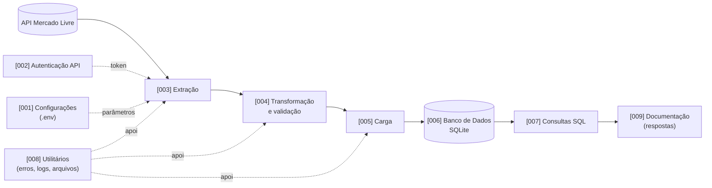
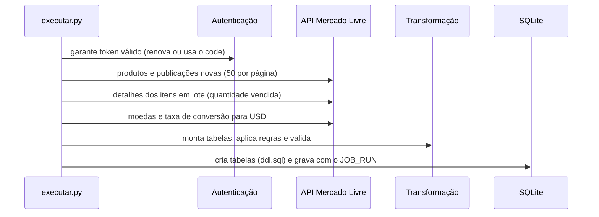
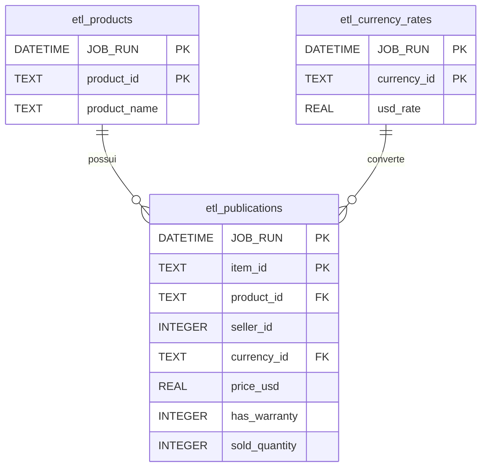

<div align="center">

# Desafio ETL — Mercado Livre
## Objetivo do projeto

Apoiar um vendedor *Best Seller* do Mercado Libre Argentina com dados das publicações de **Samsung Galaxy S24** (somente produtos novos), respondendo:

1. Existe vendedor com múltiplas publicações? Quantas?
2. Qual a média de vendas por vendedor?
3. Qual o preço médio em dólares?
4. Qual o percentual de itens com garantia?
5. Quais métodos de envio são oferecidos? 

A automação acessa as APIs públicas (`/currencies`, `/currency_conversions`, `/search`, `/items`), pagina de 50 em 50 registros, grava em banco local e inclui o campo `JOB_RUN` (mesma data/hora para todos os registros de uma execução) em todas as tabelas.

## Arquitetura da solução



## Fluxo ETL



## Estrutura de diretórios

```text
.
├── [001] - Configuracoes/
│   └── configuracoes.py            # configuração central (lê o .env)
├── [002] - Autenticacao API/
│   └── autenticacao_oauth.py       # OAuth, access token e refresh token
├── [003] - Extracao/
│   ├── cliente_api.py              # sessão HTTP, retry e paginação
│   ├── extracao_publicacoes.py     # produtos e publicações novas
│   ├── extracao_itens.py           # detalhes dos itens (em lote)
│   └── extracao_moedas.py          # moedas e taxas de conversão
├── [004] - Transformacao/
│   ├── regras_garantia.py          # regra de garantia
│   ├── transformacao_publicacoes.py
│   └── validacao_publicacoes.py    # validação de qualidade
├── [005] - Carga/
│   └── carga_publicacoes.py        # gravação em lote e transacional
├── [006] - Banco de Dados/
│   ├── ddl.sql                     # modelo de dados
│   ├── conexao_banco.py
│   ├── criacao_tabelas.py
│   └── intermediarios/             # saídas das etapas (não versionado)
├── [007] - Consultas SQL/
│   ├── consultas.sql               # queries do desafio
│   └── executar_consultas.py
├── [008] - Utilitarios/
│   ├── excecoes.py · logs.py · arquivos.py
│   └── logs/                       # arquivo etl.log (não versionado)
├── [009] - Documentacao/
│   ├── [Respostas] - Desafio ETL Mercado Livre.md
│   ├── Arquitetura.md · Dicionario de Dados.md · Revisao Tecnica.md
├── caminhos_projeto.py             # registra as pastas numeradas no Python
├── executar.py                     # ponto de entrada do ETL
├── autenticar.py                   # apoio: gerar tokens
├── .env.example · .gitignore · requirements.txt
└── README.md
```

> Os nomes das pastas têm colchetes e espaços, então não são pacotes Python. `caminhos_projeto.py` as adiciona ao caminho de importação e os módulos são importados pelo nome do arquivo (ex.: `from configuracoes import TAMANHO_PAGINA`). Por isso, **os nomes dos arquivos `.py` são únicos** em todo o projeto.

## Como instalar as dependências

Requisito: Python 3.12 ou superior.

```powershell
python -m venv .venv
.venv\Scripts\Activate.ps1          # Linux/macOS: source .venv/bin/activate
pip install -r requirements.txt
```

Dependências: `requests` e `python-dotenv` (o SQLite já vem com o Python).

## Como configurar o ambiente

```powershell
copy .env.example .env              # Linux/macOS: cp .env.example .env
```

Preencha no `.env` os dados da sua aplicação cadastrada no DevCenter do Mercado Libre:

| Variável | Descrição |
|---|---|
| `ML_APP_ID` | Client ID da aplicação |
| `ML_CLIENT_SECRET` | Client Secret da aplicação |
| `ML_CODE` | Code de autorização (uso único; só na 1ª execução) |
| `ML_REDIRECT_URI` | Opcional; igual ao cadastrado na aplicação |

Os demais parâmetros (URL, endpoints, produto pesquisado, paginação, banco) já vêm com valor padrão em `.env.example` e são centralizados em `[001] - Configuracoes/configuracoes.py`.

> O `.env` está no `.gitignore`. **Nunca** publique Client ID, Client Secret, code ou tokens no GitHub nem os cole em conversas ou prompts.

**Primeira autenticação:** na primeira execução o `ML_CODE` é trocado por `ML_ACCESS_TOKEN` e `ML_REFRESH_TOKEN` (gravados no `.env`) e o code é removido. Depois disso o token é renovado automaticamente. Se o code expirar (vale poucos minutos), gere outro:

```bash
python autenticar.py --url              # exige ML_REDIRECT_URI; abra a URL e autorize
python autenticar.py --codigo TG-xxxx   # troca o code por tokens
```

## Como executar o projeto

```bash
python executar.py
```

Executa Extração → Transformação → Carga. Retorna código `0` em sucesso e `1` em erro; os logs vão para o console e para `[008] - Utilitarios/logs/etl.log`.

## Como executar cada etapa

```bash
python executar.py --etapa extracao        # 1) API -> [006]/intermediarios/1_extracao.json
python executar.py --etapa transformacao   # 2) lê o 1 -> 2_transformacao.json (valida os dados)
python executar.py --etapa carga           # 3) lê o 2 -> grava no banco SQLite
python executar.py --etapa consultas       # 4) roda consultas.sql -> Resultados da Ultima Execucao.md
```

As etapas devem ser executadas nessa ordem. Rodar a carga duas vezes com o mesmo arquivo é bloqueado (mesmo `JOB_RUN`).

## Modelagem de dados



Todas as tabelas têm `JOB_RUN`, o que preserva o histórico de execuções. O dicionário completo está em [`[009] - Documentacao/Dicionario de Dados.md`](%5B009%5D%20-%20Documentacao/Dicionario%20de%20Dados.md).

## DDL das tabelas

Arquivo `[006] - Banco de Dados/ddl.sql` (executado automaticamente pelo ETL):

```sql
CREATE TABLE IF NOT EXISTS etl_products (
    JOB_RUN      DATETIME NOT NULL,
    product_id   TEXT     NOT NULL,
    product_name TEXT,
    PRIMARY KEY (JOB_RUN, product_id)
);

CREATE TABLE IF NOT EXISTS etl_currency_rates (
    JOB_RUN     DATETIME NOT NULL,
    currency_id TEXT     NOT NULL,
    usd_rate    REAL,
    PRIMARY KEY (JOB_RUN, currency_id)
);

CREATE TABLE IF NOT EXISTS etl_publications (
    JOB_RUN                DATETIME NOT NULL,
    item_id                TEXT     NOT NULL,
    product_id             TEXT     NOT NULL,
    seller_id              INTEGER  NOT NULL,
    price                  REAL,
    currency_id            TEXT,
    price_usd              REAL,
    condition              TEXT,
    warranty               TEXT,
    has_warranty           INTEGER  NOT NULL CHECK (has_warranty IN (0, 1)),
    listing_type_id        TEXT,
    shipping_mode          TEXT,
    shipping_logistic_type TEXT,
    shipping_free          INTEGER  CHECK (shipping_free IN (0, 1)),
    sold_quantity          INTEGER,
    PRIMARY KEY (JOB_RUN, item_id),
    FOREIGN KEY (JOB_RUN, product_id)  REFERENCES etl_products (JOB_RUN, product_id),
    FOREIGN KEY (JOB_RUN, currency_id) REFERENCES etl_currency_rates (JOB_RUN, currency_id)
);

CREATE INDEX IF NOT EXISTS idx_publications_seller  ON etl_publications (JOB_RUN, seller_id);
CREATE INDEX IF NOT EXISTS idx_publications_product ON etl_publications (JOB_RUN, product_id);
```

## Queries do desafio

Todas consideram apenas a **última execução**. Arquivo: `[007] - Consultas SQL/consultas.sql`.

**1. Vendedores com múltiplas publicações (e quantas)**
```sql
SELECT seller_id, COUNT(*) AS publication_count
FROM etl_publications
WHERE JOB_RUN = (SELECT MAX(JOB_RUN) FROM etl_publications)
GROUP BY seller_id
HAVING COUNT(*) > 1
ORDER BY publication_count DESC;
```

**1 (complemento). Quantidade de publicações por vendedor**
```sql
SELECT seller_id, COUNT(*) AS publication_count
FROM etl_publications
WHERE JOB_RUN = (SELECT MAX(JOB_RUN) FROM etl_publications)
GROUP BY seller_id
ORDER BY publication_count DESC, seller_id;
```

**2. Média de vendas por vendedor**
```sql
SELECT seller_id, ROUND(AVG(sold_quantity), 2) AS average_sales
FROM etl_publications
WHERE JOB_RUN = (SELECT MAX(JOB_RUN) FROM etl_publications)
  AND sold_quantity IS NOT NULL
GROUP BY seller_id
ORDER BY average_sales DESC;
```

**3. Preço médio em dólar**
```sql
SELECT ROUND(AVG(price_usd), 2) AS average_price_usd
FROM etl_publications
WHERE JOB_RUN = (SELECT MAX(JOB_RUN) FROM etl_publications)
  AND price_usd IS NOT NULL;
```

**4. Percentual de itens com garantia**
```sql
SELECT ROUND(100.0 * SUM(has_warranty) / COUNT(*), 2) AS warranty_percentage
FROM etl_publications
WHERE JOB_RUN = (SELECT MAX(JOB_RUN) FROM etl_publications);
```

**5. Métodos de envio utilizados**
```sql
SELECT shipping_mode, shipping_logistic_type, shipping_free, COUNT(*) AS publication_count
FROM etl_publications
WHERE JOB_RUN = (SELECT MAX(JOB_RUN) FROM etl_publications)
GROUP BY shipping_mode, shipping_logistic_type, shipping_free
ORDER BY publication_count DESC;
```

## Respostas do case API / ETL

Documento completo (respostas, SQL, lógica e evidências): [`[Respostas] - Desafio ETL Mercado Livre`](%5B009%5D%20-%20Documentacao/%5BRespostas%5D%20-%20Desafio%20ETL%20Mercado%20Livre.md).

| Pergunta | Resposta (execução de 07/09/2026, 16 publicações) |
|---|---|
| 1 | Sim: vendedor `214988544` com 2 publicações |
| 2 | Indisponível: `/items` retornou HTTP 403 (quantidade vendida nula) |
| 3 | US$ 1.067,88 |
| 4 | 81,25% (13 de 16)* |
| 5 | `me2` com frete grátis: 7 `drop_off`, 7 `xd_drop_off`, 2 `cross_docking` |

\* Calculado antes da correção da regra de garantia. Reexecute o ETL e `python executar.py --etapa consultas` para os valores atualizados.

## Tecnologias utilizadas

| Tecnologia | Uso |
|---|---|
| Python 3.12 | Linguagem |
| Requests | Chamadas HTTP com retry e *backoff* |
| python-dotenv | Leitura do `.env` |
| SQLite | Banco de dados local |
| SQL | Modelagem e consultas analíticas |
| Mermaid | Diagramas da documentação |

## Oportunidades de melhoria

- Migrar de SQLite para PostgreSQL ou BigQuery.
- Criar tabela de controle de execuções (início, fim, status, quantidade, erros).
- Paralelizar as chamadas por produto respeitando o limite de requisições.
- Automatizar testes (unitários e de contrato com respostas gravadas da API) e CI.
- Agendar a execução (Task Scheduler, cron ou Airflow) e containerizar.
- Publicar um painel analítico (por exemplo, Looker Studio sobre BigQuery).
- Evoluir o modelo para dimensional (vendedor, produto, envio).

## Autor

**Autor: Pablo Felix**
